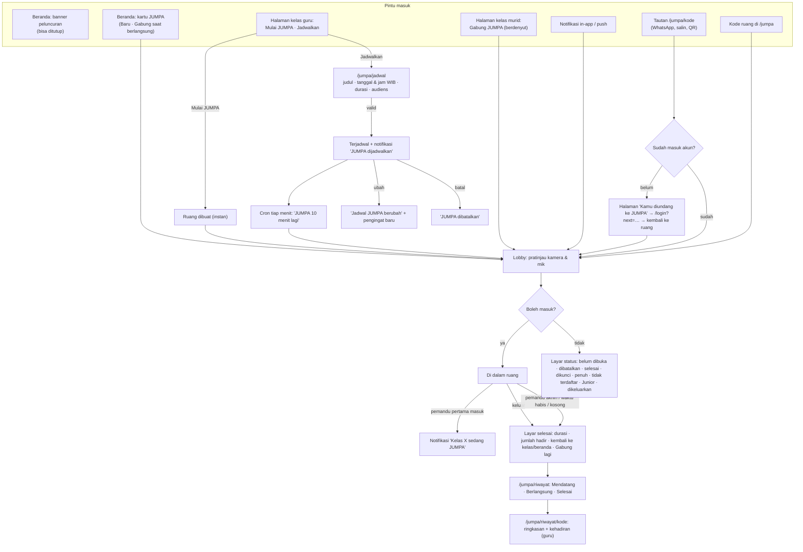

# JUMPA — Alur Penggunaan

Dokumen ini menjelaskan JUMPA (ruang video kelas BahasaCerdas) dari sisi pengguna: siapa melakukan apa, layar dan status yang dilihat, notifikasi yang dikirim, dan daftar celah yang sudah diperiksa.

Semua fitur di sini **berada di balik flag** `NEXT_PUBLIC_JUMPA_ENABLED` (UI) / `ENABLE_JUMPA` (server). Bila flag mati, banner, kartu, panel kelas, halaman `/jumpa/*`, API `/api/jumpa/*`, dan cron pengingat tidak tampil atau tidak berjalan.

Dokumen teknis terkait: `JUMPA_TECHNICAL_PLAN.md`, `JUMPA_PHASE1.md`, `JUMPA_PHASE2.md`, `JUMPA_PHASE3_PERFORMA_TIER.md`, `PANDUAN_DESAIN_BC.md`.

---

## 1. Peran

| Peran | Bisa | Tidak bisa |
|---|---|---|
| **Guru** (termasuk founder) | Mulai JUMPA instan dari kelasnya, menjadwalkan JUMPA kelas / ruang guru, mengundang kelas lain atau orang tertentu, mengubah & membatalkan jadwal buatannya, membagikan tautan / kode / QR, mengendalikan ruang (bisu, keluarkan, kunci, akhiri), melihat kehadiran | Masuk kelas guru lain tanpa diundang |
| **Murid** | Gabung JUMPA kelasnya (dari beranda, halaman kelas, notifikasi, tautan, atau kode), membuat ruang belajar bareng (Fase 2), membagikan tautan ke teman sekelas | Menjadwalkan JUMPA, masuk kelas yang bukan kelasnya, melihat kehadiran per orang |
| **Murid Junior** (Arena Junior) | Gabung JUMPA kelas bila anggota kelas | Membuat / ikut ruang belajar bareng, menjadwalkan, menerima notifikasi siaran JUMPA |
| **Admin** (non-founder) | Panel pantau `/jumpa/pantau` | Ikut ruang |

## 2. Diagram alur

## 3. Alur per peran

### 3.1 Guru — JUMPA instan

1. Buka **Kelasku → pilih kelas**. Panel **JUMPA** (lencana **Baru**) ada tepat di bawah kartu kelas, terlihat tanpa menggulir di HP 360px.
2. Sakelar **Beri tahu kelas** di bawah tombol (nyala bawaan). Ketuk **Mulai JUMPA** → lobby → **Gabung sekarang**.
3. Saat guru (pemandu) pertama kali masuk, ruang menjadi **Berlangsung**. Bila **Beri tahu kelas** nyala, murid kelas itu menerima notifikasi **"Kelas X sedang JUMPA · Gabung sekarang."**. Bila mati, tidak ada notifikasi (cocok untuk mencoba kamera dulu).
4. Murid melihat **Gabung JUMPA** berdenyut di halaman kelas dan di paling atas beranda.
5. Di dalam ruang: **Lainnya → Bagikan ruang** membuka lembar bagikan.
6. Selesai: **Lainnya → Akhiri untuk semua** (atau batas waktu paket / ruang kosong). Guru melihat **layar selesai** dengan durasi, jumlah hadir, dan daftar kehadiran.

Ruang instan yang dibuat dalam 15 menit dipakai ulang, sehingga mengetuk dua kali tidak membuat dua ruang. Jadwal yang mulai dalam 15 menit juga dipakai ulang, sehingga **Mulai JUMPA** langsung membuka jadwal itu.

### 3.2 Guru — menjadwalkan

1. **Jadwalkan** dari panel kelas (kelas terisi otomatis), dari kartu beranda, dari `/jumpa`, atau dari `/jumpa/riwayat`.
2. Isi formulir `/jumpa/jadwal`:
   - **Jenis**: Kelas / Ruang guru.
   - **Kelas** (untuk JUMPA kelas) atau **Komunitas** (opsional, untuk ruang guru).
   - **Judul** (opsional; kosong → "JUMPA {kelas}").
   - **Tanggal** dan **Jam (WIB)**: minimal 5 menit dari sekarang, maksimal 60 hari ke depan.
   - **Durasi**: pilihan 15 / 30 / 45 / 60 / 90 / 120 menit, dibatasi paket (Gratis 45 menit; Premium 120 menit).
   - **Kelas lain (opsional)**: hanya kelas milik guru itu.
   - **Undang orang tertentu (opsional)**: guru dan murid kelasnya untuk JUMPA kelas, atau guru untuk ruang guru; maksimal 30 orang.
3. **Jadwalkan** → layar **JUMPA terjadwal** menampilkan waktu, "N orang diberi tahu", **Bagikan**, **Lihat semua jadwal**, dan **Selesai**.
4. Kuota harian paket (Gratis 3 ruang per hari) dihitung pada **hari jadwal**. Jadwal yang dibatalkan tidak dihitung.
5. **Ubah / batalkan**: `/jumpa/riwayat` → ikon pensil → `/jumpa/jadwal?ubah=kode`. Hanya pembuat jadwal, dan hanya sebelum ruang dimulai.

### 3.3 Murid

- **Beranda**:
  - Saat kelasnya berlangsung, kartu **Berlangsung → Gabung JUMPA** muncul paling atas, di atas hero.
  - Di bawah hero ada kartu JUMPA (**Baru**, jadwal berikutnya bila ada) dan banner peluncuran.
- **Halaman kelas**: panel muncul hanya bila ada yang berlangsung (**Gabung JUMPA**) atau ada jadwal (waktu berikutnya). Bila tidak ada keduanya, panel tidak tampil.
- **Jadwal**: murid bisa membuka lobby kapan saja. Tombol masuk terbuka **10 menit sebelum jam mulai**, atau lebih awal bila guru sudah memulai. Sebelum itu tampil **"JUMPA belum dibuka · Dibuka pukul 10.20 WIB"**, dan halaman menyegarkan diri sendiri.
- **Riwayat**: `/jumpa/riwayat` menampilkan Mendatang, Berlangsung, dan Selesai (60 hari). Ringkasan tanpa daftar kehadiran per orang.

### 3.4 Tautan, kode, QR

- **Bagikan** tersedia di panel kelas, riwayat, layar terjadwal, lobby, dan menu ruang. Pilihannya:
  - **Bagikan** (Web Share, hanya di HP).
  - **WhatsApp**, dengan teks: "Yuk gabung JUMPA: {judul} · {waktu}. Masuk pakai akun BahasaCerdas: {tautan}".
  - **Salin tautan**.
  - **Kode** (salin).
  - **Tautan undangan 24 jam**: hanya ruang guru, oleh pemandu.
  - **QR**: hanya laptop/desktop.
- Tautan biasa `/jumpa/{kode}` hanya bisa dipakai akun yang memang terdaftar di ruang (anggota kelas / diundang). Tautan 24 jam mengizinkan guru lain masuk ruang guru; yang disimpan hanya hash-nya.
- **Pratinjau tautan** (WhatsApp dan sejenisnya) memakai gambar 1200×630 `/jumpa/og-jumpa-1200x630.jpg` dengan teks umum "Gabung JUMPA — BahasaCerdas". Judul ruang dan nama kelas sengaja **tidak** ditampilkan (keamanan anak). Halaman tetap `noindex`.
- **Belum login**: tautan menampilkan "Kamu diundang ke JUMPA", lalu otomatis ke `/login?next=/jumpa/{kode}` dan kembali ke ruang setelah login. Parameter undangan `?u=` ikut terbawa.

## 4. Layar dan status

| Layar | Lokasi | Status yang ditangani |
|---|---|---|
| Banner peluncuran | Beranda guru & murid | Tampil sampai ditutup (`localStorage` `bc-jumpa-banner-v1:{userId}` di guru) · flag mati → tidak ada |
| Kartu JUMPA | Beranda guru & murid | Berlangsung (Gabung / Masuk lagi, denyut) · jadwal berikutnya · kosong ("Ruang video kelas.") · polling 60 detik saat tab terlihat |
| Panel JUMPA kelas | Kelasku guru (`?kelas=` tautan langsung) & kelas murid | Guru: Mulai / Masuk lagi, Jadwalkan, Bagikan, maksimal 3 jadwal, kehadiran terakhir. Murid: Gabung (denyut) / jadwal berikutnya / tersembunyi. Polling 30 detik |
| Formulir jadwal | `/jumpa/jadwal` | Bukan guru → "Hanya guru yang bisa menjadwalkan" · `?ubah=` bukan milik sendiri / sudah dimulai → "Jadwal tidak bisa diubah" · galat validasi di bawah formulir · berhasil / diperbarui / dibatalkan |
| Lembar bagikan | Modal (desktop) / lembar bawah (HP) | Tersalin · tautan 24 jam dibuat · QR (desktop) · Escape / ketuk luar menutup |
| Lobby | `/jumpa/{kode}` | Bisa masuk · jadwal ("Besok · 10.30 WIB") · lihat 4.1 |
| Di dalam ruang | `/jumpa/{kode}` | Fitur Fase 1–3 (lihat 4.2) |
| Layar selesai | `/jumpa/{kode}` setelah keluar/berakhir | Durasi · jumlah hadir · kehadiran per orang (guru pemilik/pembuat & admin) · Kembali ke kelas / beranda · Riwayat · Gabung lagi (bila hanya keluar) · ajakan Premium bila waktu habis (guru Gratis) |
| Riwayat & jadwal | `/jumpa/riwayat` | Tab Mendatang / Berlangsung / Selesai dengan jumlah · kosong per tab · Dibatalkan · ubah (pembuat) · bagikan |
| Ringkasan | `/jumpa/riwayat/{kode}` | Selesai / berlangsung / belum dimulai / dibatalkan · bukan peserta & bukan pemilik → 404 |

### 4.1 Layar status lobby (tidak bisa masuk)

| Kode | Judul | Kalimat | Aksi |
|---|---|---|---|
| `NOT_STARTED` | JUMPA belum dibuka | Dibuka pukul HH.MM WIB. Halaman ini akan terbuka sendiri. | Segar otomatis |
| `ROOM_CANCELLED` | JUMPA dibatalkan | Cek jadwal terbaru di riwayat. | Lihat riwayat |
| `ROOM_ENDED` / `ROOM_EXPIRED` | JUMPA sudah selesai | — | Lihat riwayat |
| `ROOM_LOCKED` | Ruang dikunci | Tunggu pemandu membukanya. | Coba lagi |
| `ROOM_FULL` | Ruang penuh | Batas paket N orang. Coba lagi saat ada yang keluar. | Coba lagi |
| `NOT_INVITED` / `NOT_GROUP_MEMBER` / `NOT_COMMUNITY_MEMBER` | Kamu tidak terdaftar | Pesan server | — |
| `REMOVED` | Kamu sudah dikeluarkan | — | — |
| `JUNIOR_NOT_ALLOWED` | Belum untuk akun Junior | Pesan server | — |
| Kuota harian (saat membuat/menjadwalkan) | Lembar Premium (instan) / galat formulir "Kuota 3 ruang di hari itu sudah habis. Pilih hari lain." | | |

### 4.2 Di dalam ruang (Fase 1–3, tidak diubah kecuali "Bagikan")

- Mik, kamera, berbagi layar, angkat tangan, reaksi, obrolan (dengan moderasi), tata letak kisi / pembicara, pengaturan kualitas.
- Kendali pemandu: bisukan, keluarkan, kunci, jadikan wakil pemandu, izin layar murid, undang peserta, akhiri untuk semua.
- Laporan peserta, hitung mundur 10 menit terakhir, dan ajakan Premium untuk guru Gratis.
- **Baru**:
  - "Salin tautan ruang" diganti **Bagikan ruang**, yang membuka lembar bagikan.
  - Kartu "Menunggu peserta lain" punya tombol **Bagikan**.

## 5. Notifikasi

Semua lewat sistem yang ada:

- **In-app**: baris `Notifikasi` dengan `data.link`, tampil di lonceng.
- **Web Push** (`lib/push.ts`): hanya ke perangkat yang sudah mengizinkan push. Itu satu-satunya preferensi notifikasi yang ada di BC saat ini. Belum ada notifikasi email.

Setiap notifikasi dicatat di `JumpaNotice` dengan `dedupeKey` unik, sehingga tidak pernah terkirim dua kali walau cron atau permintaan terulang.

| Kapan | Penerima | Judul | Isi | Tautan |
|---|---|---|---|---|
| Jadwal dibuat | Anggota kelas (+ kelas lain) / anggota komunitas + undangan perorangan | JUMPA dijadwalkan | {judul} · Besok · 08.00 WIB | `/jumpa/{kode}` |
| 10 menit sebelum mulai (cron tiap menit) | Sama + pembuat | JUMPA 10 menit lagi | {judul} · mulai 08.00 WIB | `/jumpa/{kode}` |
| Pemandu pertama masuk (instan & jadwal) | Sama | Kelas 7A sedang JUMPA (ruang guru: JUMPA sedang berlangsung) | Gabung sekarang. | `/jumpa/{kode}` |
| Jadwal diubah | Sama | Jadwal JUMPA berubah | {judul} · {waktu baru} | `/jumpa/{kode}` |
| Jadwal dibatalkan | Sama | JUMPA dibatalkan | {judul} · {waktu} | `/jumpa/riwayat` |
| Peserta melapor | Guru pemandu/pembuat, guru pemilik kelas, admin | Laporan JUMPA baru | {kategori} · {judul} | `/jumpa/pantau?ruang={kode}` |

Aturan:

- **Beri tahu kelas** (`JumpaRoom.notifyClass`, nyala bawaan): sakelar di panel kelas (rapat instan), form jadwal, dan ruang guru ber-komunitas di `/jumpa`. Bila mati, kelas/komunitas (termasuk kelas tambahan) tidak menerima notifikasi apa pun untuk rapat itu: berlangsung, dijadwalkan, pengingat 10 menit, diubah, dibatalkan. Yang tetap menerima: orang yang diundang satu per satu dan pengingat untuk pembuat. Server yang menegakkan (`noticeAudience`), bukan hanya UI.
- **Ruang belajar bareng (MURID) tidak pernah menyiarkan notifikasi.**
- Pembuat tidak menerima "dijadwalkan" / "berlangsung" untuk ruangnya sendiri.
- Akun Junior tidak menerima siaran.
- Maksimal 500 penerima per notifikasi.
- **Jam tenang push murid**: 21.00–05.59 WIB push tidak dikirim, tetapi notifikasi in-app tetap tersimpan.
- Push dikirim per 25 penerima. Kegagalan push tidak menggagalkan jadwal atau masuk ruang (`deliverRoomNotice` tidak pernah melempar galat).
- Ubah jadwal membuat kunci pengingat baru, jadi pengingat 10 menit dikirim lagi untuk jam yang baru.

## 6. Data dan operasional

- **Migrasi** `20261019000000_jumpa_flow`:
  - Tabel `JumpaNotice` dengan RLS **aktif tanpa policy** (akses hanya lewat Prisma/BYPASSRLS).
  - Indeks `JumpaRoom(status, scheduledAt)`.
  - Kolom `JumpaRoom.notifyClass BOOLEAN NOT NULL DEFAULT true` ("Beri tahu kelas"; ruang lama tetap memberi tahu seperti sebelumnya).
  - **Kode baru membaca kolom ini**, jadi terapkan migrasi **sebelum** kode ini aktif (aditif, aman untuk kode lama).
  - Jadwal memakai kolom yang sudah ada: `JumpaRoom.status = SCHEDULED`, `scheduledAt`, dan `maxDurationMin` (durasi pilihan, dibatasi paket). Pembatalan: `status = ENDED`, `endReason = CANCELLED`.
  - Terapkan lewat `ops/vps/jumpa-setup.sh` (sudah memuat migrasi ini) atau `psql -f` lalu `prisma migrate resolve --applied 20261019000000_jumpa_flow`. **Jangan** `migrate deploy`.
- **Cron**: `* * * * * /usr/local/bin/bc-cron-call /api/cron/jumpa-reminders`.
  - Sama seperti sweep: Bearer `CRON_SECRET`, fail-closed, dilewati saat flag mati.
  - Kontainer cron perlu dimuat ulang agar baris baru terbaca.
- **Sweep**: ruang SCHEDULED basi dihitung 24 jam dari `scheduledAt` (sebelumnya dari `createdAt`), jadi jadwal jauh hari tidak ikut ditutup.
- **Health** `/api/jumpa/health`: `storage` bernilai `phase2-only` sampai migrasi ini diterapkan.

## 7. Daftar celah (diperiksa)

Keterangan: [x] sudah ditangani dan diuji · [ ] belum / keputusan.

**Masuk & izin**

- [x] Murid tidak bisa menjadwalkan, baik di API (`ROLE_NOT_ALLOWED`) maupun di UI (formulir menampilkan pesan, tombol tidak ada).
- [x] Non-anggota tidak bisa masuk (`NOT_INVITED`), termasuk guru lain di ruang kelas dan murid di ruang guru.
- [x] Tautan tanpa login → login → kembali ke ruang, `?u=` terbawa.
- [x] Masuk sebelum dibuka → layar "belum dibuka" yang menyegarkan sendiri. Pemandu boleh membuka lebih awal.
- [x] Ruang dibatalkan → `ROOM_CANCELLED` (410), bukan "selesai".
- [x] Kuota harian dihitung pada hari jadwal, jadwal batal tidak dihitung. Pesan "Pilih hari lain."
- [x] Durasi di atas batas paket ditolak (`DURATION_OVER_LIMIT`). Durasi harus kelipatan 5 dan minimal 15.
- [x] Tanggal tidak valid (31 Februari, jam 24) ditolak. Jam dihitung WIB, tidak bergantung zona waktu server/perangkat.

**Notifikasi**

- [x] Idempoten (`JumpaNotice.dedupeKey` unik). Cron dua kali → satu pengingat (diuji lokal).
- [x] Ruang MURID tidak menyiarkan. Junior dan pembuat dikecualikan.
- [x] Jam tenang push murid.
- [x] Nama kelas berawalan "Kelas" tidak diulang ("Kelas Kelas 7A").

**Data**

- [x] Sweep tidak menutup jadwal jauh hari.
- [x] Kehadiran per orang hanya untuk guru pemilik/pembuat & admin.

**UI**

- [x] UI hanya Bahasa Indonesia (`test:jumpa-no-english`). Tanpa emoji sebagai ikon (lucide). Token `--clr-*`, tanpa hex di CSS baru. Tombol ≥ 44px. Layar 360px diperiksa.
- [x] Lonceng notifikasi tidak terpotong di 360px (perbaikan umum kecil di `NotificationBell`).

**Keputusan & batasan**

- [x] **Notifikasi "sedang JUMPA" untuk ruang instan**: keputusan CEO, sakelar **Beri tahu kelas** (nyala bawaan) di panel kelas dan form jadwal. Mati = tanpa notifikasi kelas untuk rapat itu.
- [ ] **Kehadiran bergantung webhook LiveKit** (`/api/jumpa/webhook`, sudah ada sejak Fase 2). Bila webhook tidak sampai, "Hadir" = 0. Token yang diterbitkan tidak dihitung sebagai hadir.
- [ ] **Tidak ada notifikasi email.** BC belum punya sistem email notifikasi. Preferensi yang dihormati hanya izin push per perangkat.
- [ ] **Tautan 24 jam hanya untuk ruang guru** (perilaku Fase 2). Ruang kelas cukup tautan biasa, karena hanya anggota yang bisa masuk.
- [ ] Pengulangan jadwal (mingguan) belum ada.
- [ ] Ruang belajar bareng (MURID) tidak bisa dijadwalkan.
- [ ] Panel kelas menampilkan jadwal yang terikat ke kelas itu. Jadwal kelas lain yang **mengundang** kelas ini tampil di riwayat dan notifikasi, tetapi tidak di panel.

## 8. Pengujian

- `npm run test:jumpa-flow`: jadwal (WIB, validasi, durasi paket), izin (murid tidak bisa menjadwalkan, non-anggota ditolak), gerbang ruang terjadwal, teks & penerima notifikasi, idempotensi, jam tenang, pengingat, sweep, cron, migrasi RLS, dan cek statis UI (flag, token warna, teks banner, aset).
- Seluruh `test:jumpa-*` berjalan di CI (langkah "JUMPA permission + token gates").
